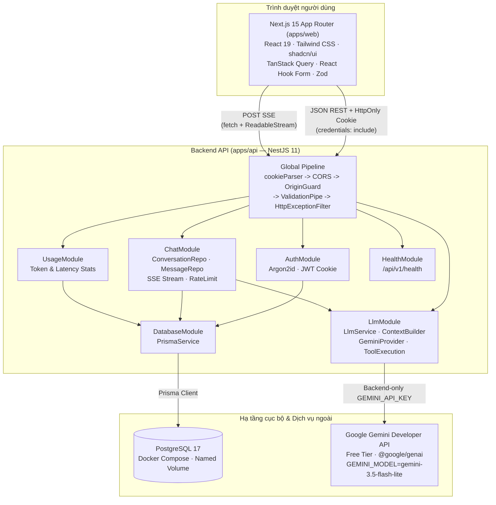
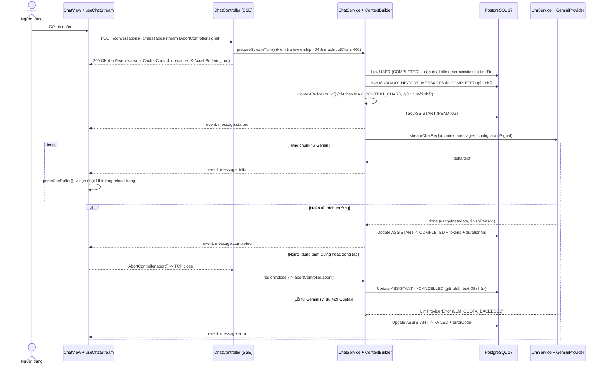
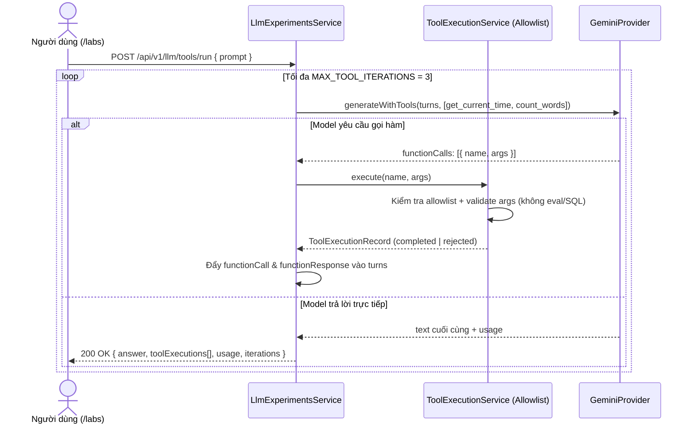

# Kiến trúc hệ thống — Nexa Chat

## 1. Tổng quan hệ thống

**Nexa Chat** là monorepo `pnpm` được thiết kế theo triết lý **production-oriented, tối giản hạ tầng**: chỉ gồm 1 Backend NestJS, 1 Frontend Next.js App Router và 1 cơ sở dữ liệu PostgreSQL 17 chạy trong Docker Compose.



---

## 2. Quy tắc phụ thuộc giữa các Feature (Dependency Rules)

### Backend (`apps/api/src/`)
| Feature / Tầng | Trách nhiệm duy nhất | Được phép phụ thuộc | Cấm phụ thuộc |
|---|---|---|---|
| `config/` | Nạp & validate env fail-fast | Không phụ thuộc feature nào | Mọi `features/*` |
| `database/` | Kết nối Prisma (`@Global`) | `config/` | Mọi `features/*` |
| `common/` | Guards (`OriginGuard`, `UserRateLimitGuard`), `HttpExceptionFilter`, `RequestLoggingInterceptor`, `@CurrentUser` | `config/` | Logic nghiệp vụ trong `chat/`, `llm/` |
| `features/auth/` | Đăng ký, đăng nhập, đăng xuất, `/me`, `JwtAuthGuard` | `database/`, `config/` | `chat/`, `llm/`, `usage/` |
| `features/llm/` | Giao tiếp Gemini, system prompt, context builder, structured output, tool execution | `config/`, `common/` | `chat/`, `database/` (stateless!) |
| `features/chat/` | CRUD hội thoại, lưu lịch sử, sinh title tất định, điều phối stream SSE | `database/`, `llm/`, `auth/`, `common/` | Gọi trực tiếp `@google/genai` |
| `features/usage/` | Tổng hợp token & độ trễ theo userId | `database/`, `config/`, `auth/` | `chat/`, `llm/` |

> **Nguyên tắc vàng:** `LlmModule` không biết gì về database hay hội thoại; `ChatModule` không biết gì về SDK `@google/genai`. Nhờ vậy hai module có thể kiểm thử độc lập và thay thế sạch sẽ.

### Frontend (`apps/web/src/`)
- `src/app/`: chỉ khai báo route và bố cục (composition), không chứa logic gọi API hay state phức tạp.
- `src/features/<feature>/`: tự sở hữu `api/`, `hooks/`, `schemas/`, `types/`, `components/`.
- `src/lib/api-client.ts`: điểm duy nhất gọi REST API (tự động gắn `credentials: 'include'` và ánh xạ lỗi về `ApiError`).
- `src/features/chat/api/chat-stream-api.ts`: điểm duy nhất gọi SSE stream qua `fetch` + `ReadableStream`.

---

## 3. Sơ đồ trình tự các luồng cốt lõi (Sequence Diagrams)

### 3.1. Luồng Đăng nhập & Xác thực Cookie

```mermaid
sequenceDiagram
  actor U as Người dùng
  participant W as Next.js Web (localhost:3000)
  participant G as OriginGuard + ValidationPipe
  participant A as AuthController / AuthService
  participant DB as PostgreSQL 17

  U->>W: Nhập Email & Mật khẩu (/login)
  W->>G: POST /api/v1/auth/login (Origin: http://localhost:3000, credentials: include)
  G->>G: Kiểm tra Origin == CORS_ORIGIN & validate LoginDto
  G->>A: Gọi AuthService.login()
  A->>DB: SELECT user WHERE email = lowercase(trim(email))
  DB-->>A: Trả bản ghi (có passwordHash)
  A->>A: argon2.verify(passwordHash, plainPassword)
  A->>A: jwtService.signAsync({ sub: user.id, email })
  A-->>W: 200 OK + Set-Cookie (HttpOnly; SameSite=Lax) + { user (không có passwordHash) }
  W->>W: Cập nhật AuthProvider cache -> chuyển hướng /chat
```

### 3.2. Luồng Chat Streaming (SSE) & Hủy giữa chừng (Stop / Disconnect)



### 3.3. Luồng Function Calling an toàn (`/api/v1/llm/tools/run`)



---

## 4. Mô hình bảo mật (Security Threat Model)

| Mối đe doạ | Kịch bản tấn công | Biện pháp phòng thủ trong Nexa Chat | File triển khai |
|---|---|---|---|
| **Đánh cắp JWT qua XSS** | Script lạ đọc `localStorage` | JWT chỉ nằm trong cookie `HttpOnly`; `localStorage` tuyệt đối không lưu token | `auth.controller.ts`, `jwt.strategy.ts` |
| **XSS qua Markdown của LLM** | Prompt injection ép LLM sinh `<script>` hoặc `[click](javascript:...)` | `react-markdown` dùng `skipHtml`, không bật `rehype-raw`, lọc `href` chỉ nhận `http(s):` / `mailto:` | `markdown-content.tsx` |
| **CSRF trên cookie** | Trang web độc hại gửi form POST sang API kèm cookie trình duyệt | Cookie `SameSite=Lax` + CORS đúng origin + `OriginGuard` kiểm tra `Origin`/`Referer`/`Sec-Fetch-Site` | `origin.guard.ts`, `app.setup.ts` |
| **IDOR (đọc/sửa/xoá hội thoại người khác)** | User B đoán UUID hội thoại của User A | Mọi query đi qua `ConversationRepository` bắt buộc lọc `userId` + `deletedAt: null`; trả `404` thay vì `403` | `conversation.repository.ts`, `chat.service.ts` |
| **Rò rỉ mật khẩu & hash** | Lộ DB hoặc API trả dư trường | Băm Argon2id; mọi truy vấn user dùng `PUBLIC_USER_SELECT` loại `passwordHash` | `auth.service.ts` |
| **Lộ `GEMINI_API_KEY` & phát sinh chi phí trả phí** | Client gửi trường `model: "pro"` hoặc đọc key ở bundle | Key chỉ ở backend; `ValidationPipe(forbidNonWhitelisted: true)` chặn trường lạ; không có fallback sang model trả phí | `gemini.provider.ts`, `generation-config.dto.ts` |
| **Lạm dụng Function Calling** | Prompt injection dụ model gọi hàm hệ thống / lặp vô hạn | `ToolExecutionService` chỉ chạy allowlist (`get_current_time`, `count_words`), validate tham số nghiêm ngặt, giới hạn 3 vòng | `tool-execution.service.ts`, `llm-experiments.service.ts` |
| **Lộ dữ liệu riêng tư trong log** | Log request body hoặc stack trace ra console | `RequestLoggingInterceptor` chỉ log method/path/status/duration; `HttpExceptionFilter` không trả stack trace | `request-logging.interceptor.ts`, `http-exception.filter.ts` |

---

## 5. Ma trận xử lý lỗi & độ tin cậy (Reliability Matrix)

| Tình huống lỗi | HTTP Status / SSE | Mã lỗi (`code`) | Trạng thái DB (`Message`) | Hành vi UI |
|---|---|---|---|---|
| Chưa cấu hình `GEMINI_API_KEY` | `503` / `message.error` | `LLM_API_KEY_MISSING` | `FAILED` | Hiện thông báo + nút Thử lại |
| API key sai / không hợp lệ | `502` / `message.error` | `LLM_INVALID_API_KEY` | `FAILED` | Hiện thông báo sạch (không lộ key) |
| Hết hạn mức Free Tier | `429` / `message.error` | `LLM_QUOTA_EXCEEDED` | `FAILED` | Hiện thông báo hạn mức Free Tier + Thử lại |
| Vượt tốc độ từ Google | `429` / `message.error` | `LLM_RATE_LIMITED` | `FAILED` | Hiện thông báo đợi vài giây + Thử lại |
| Vượt rate limit theo user của app | `429` (+ `Retry-After`) | `RATE_LIMITED` | Không tạo tin mới | Hiện thời gian cần chờ |
| Gemini quá tải / 5xx | `503` / `message.error` | `LLM_UNAVAILABLE` | `FAILED` | Hiện thông báo + Thử lại |
| Lỗi mạng (`ECONNRESET`, `fetch failed`) | `502` / `message.error` | `LLM_NETWORK_ERROR` | `FAILED` | Hiện thông báo kết nối mạng + Thử lại |
| Quá thời gian chờ (30s) | `504` / `message.error` | `LLM_TIMEOUT` | `FAILED` | Hiện thông báo quá giờ + Thử lại |
| Dữ liệu JSON sai schema (Stage 6) | `502` | `LLM_INVALID_OUTPUT` | Không áp dụng | Hiện cảnh báo schema không hợp lệ |
| Input sai / vượt `MAX_INPUT_CHARS` / field lạ | `400` | `VALIDATION_ERROR` / `MESSAGE_TOO_LONG` | Không lưu | Chặn ngay trên Composer / hiện lỗi |
| Chưa đăng nhập / cookie hết hạn | `401` | `UNAUTHORIZED` | Không áp dụng | Tự chuyển về `/login` |
| Sai Origin trên POST/PATCH/DELETE | `403` | `INVALID_ORIGIN` | Không áp dụng | Từ chối request |
| Truy cập hội thoại của người khác / đã xoá | `404` | `CONVERSATION_NOT_FOUND` | Không lộ dữ liệu | Hiện thông báo không tìm thấy |
| Người dùng bấm Stop / đóng tab giữa stream | Đóng kết nối SSE | `USER_CANCELLED` (`finishReason`) | `CANCELLED` (giữ partial text) | Hiện badge *Đã dừng tạo phản hồi* |
| Server crash khi đang stream | Dọn lúc khởi động | `SERVER_INTERRUPTED` (`finishReason`) | `PENDING` → `FAILED` | Không bị kẹt trạng thái đang tải |

---

## 6. Đánh đổi kiến trúc MVP & Lộ trình nâng cấp sau này

| Hạn chế hiện tại (chủ đích giữ đơn giản) | Khi nào cần nâng cấp | Hướng nâng cấp |
|---|---|---|
| `UserRateLimitGuard` lưu trong RAM tiến trình Node | Khi chạy ≥ 2 instance backend | Chuyển kho đếm sang Redis (`@nestjs/throttler` + Redis storage) |
| Ngân sách context ước lượng theo ký tự (`MAX_CONTEXT_CHARS`) | Khi cần tối ưu sát trần token với nhiều ngôn ngữ | Dùng tokenizer cục bộ hoặc `countTokens` có cache |
| Tìm kiếm hội thoại chỉ theo `title` (`ILIKE`) | Khi người dùng có hàng trăm hội thoại dài | Thêm cột `tsvector` + GIN index trên `messages.content` |
| Cookie `SameSite=Lax` yêu cầu cùng site | Khi deploy web & API lên 2 domain khác gốc | Đặt chung reverse proxy (`/api/*`) hoặc đổi `SameSite=None; Secure` kèm CSRF token |
