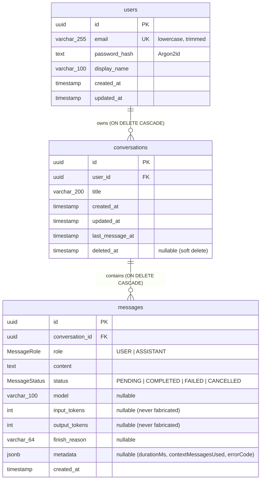
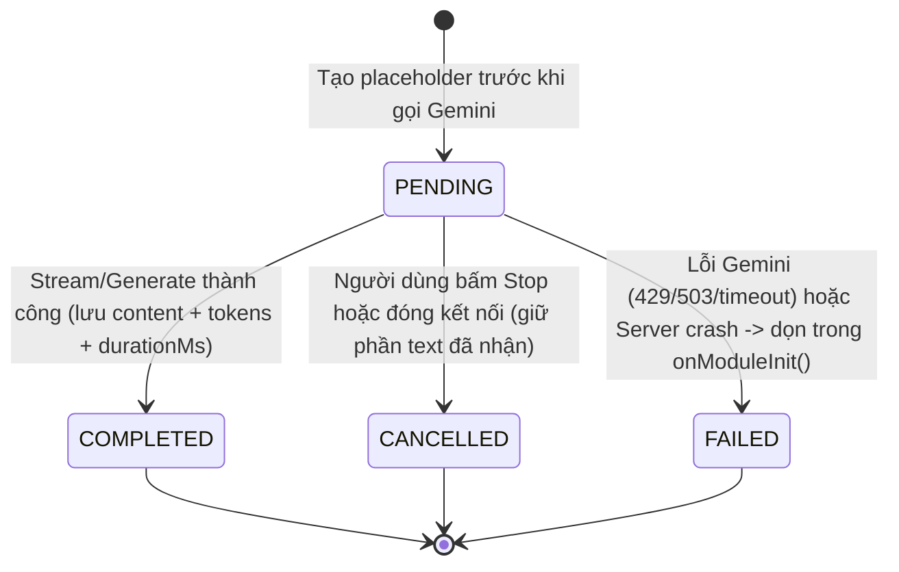

# Thiết kế Cơ sở Dữ liệu — Nexa Chat

Nexa Chat sử dụng **PostgreSQL 17** (chạy trong Docker Compose tại `infra/postgres/docker-compose.yml`) cùng **Prisma ORM v6** và quy trình migration chính thức tại `apps/api/prisma/migrations/`.

---

## 1. Sơ đồ quan hệ thực thể (ERD)



---

## 2. Chi tiết từng bảng & Enum

### Enums
- **`MessageRole`**: `USER`, `ASSISTANT`
- **`MessageStatus`**: `PENDING`, `COMPLETED`, `FAILED`, `CANCELLED`

### Bảng `users`
| Cột | Kiểu PostgreSQL | Ràng buộc | Ghi chú |
|---|---|---|---|
| `id` | `UUID` | `PRIMARY KEY` | Tự sinh UUIDv4 bởi Prisma |
| `email` | `VARCHAR(255)` | `UNIQUE NOT NULL` | Luôn chuẩn hoá `trim().toLowerCase()` ở DTO và `AuthService` |
| `password_hash` | `TEXT` | `NOT NULL` | Chuỗi hash Argon2id; bị loại trừ khỏi mọi API response bằng `PUBLIC_USER_SELECT` |
| `display_name` | `VARCHAR(100)` | `NOT NULL` | 2–80 ký tự |
| `created_at` | `TIMESTAMP(3)` | `NOT NULL DEFAULT now()` | |
| `updated_at` | `TIMESTAMP(3)` | `NOT NULL` | Tự cập nhật bởi `@updatedAt` |

### Bảng `conversations`
| Cột | Kiểu PostgreSQL | Ràng buộc | Ghi chú |
|---|---|---|---|
| `id` | `UUID` | `PRIMARY KEY` | |
| `user_id` | `UUID` | `NOT NULL FK -> users(id) ON DELETE CASCADE` | Khoá phân tách dữ liệu bắt buộc |
| `title` | `VARCHAR(200)` | `NOT NULL` | Mặc định `"Cuộc trò chuyện mới"`, tự sinh tất định ở tin đầu |
| `created_at` | `TIMESTAMP(3)` | `NOT NULL DEFAULT now()` | |
| `updated_at` | `TIMESTAMP(3)` | `NOT NULL` | |
| `last_message_at` | `TIMESTAMP(3)` | `NOT NULL DEFAULT now()` | Dùng để sắp xếp sidebar và phân nhóm Today / Previous 7 Days / Older |
| `deleted_at` | `TIMESTAMP(3)` | `NULL` | Soft delete: bản ghi `deleted_at IS NOT NULL` bị ẩn hoàn toàn ở mọi truy vấn |

### Bảng `messages`
| Cột | Kiểu PostgreSQL | Ràng buộc | Ghi chú |
|---|---|---|---|
| `id` | `UUID` | `PRIMARY KEY` | |
| `conversation_id` | `UUID` | `NOT NULL FK -> conversations(id) ON DELETE CASCADE` | |
| `role` | `MessageRole` | `NOT NULL` | `USER` hoặc `ASSISTANT` |
| `content` | `TEXT` | `NOT NULL` | Nội dung đầy đủ (hoặc phần đã stream nếu `CANCELLED`) |
| `status` | `MessageStatus` | `NOT NULL DEFAULT 'COMPLETED'` | Theo dõi chính xác vòng đời sinh phản hồi |
| `model` | `VARCHAR(100)` | `NULL` | VD: `gemini-3.5-flash-lite` (null cho tin `USER`) |
| `input_tokens` | `INTEGER` | `NULL` | Giá trị thật từ `usageMetadata.promptTokenCount`; để `NULL` nếu provider không trả |
| `output_tokens` | `INTEGER` | `NULL` | Giá trị thật từ `usageMetadata.candidatesTokenCount`; để `NULL` nếu provider không trả |
| `finish_reason` | `VARCHAR(64)` | `NULL` | VD: `STOP`, `MAX_TOKENS`, `USER_CANCELLED`, `SERVER_INTERRUPTED`, `LLM_QUOTA_EXCEEDED` |
| `metadata` | `JSONB` | `NULL` | VD: `{ "durationMs": 310, "contextMessagesUsed": 6 }` hoặc `{ "durationMs": 120, "errorCode": "LLM_QUOTA_EXCEEDED" }` |
| `created_at` | `TIMESTAMP(3)` | `NOT NULL DEFAULT now()` | |

---

## 3. Vòng đời trạng thái của Tin nhắn Trợ lý (`MessageStatus`)



> **Bất biến quan trọng:** `ContextBuilder` chỉ nạp các tin nhắn có `status = COMPLETED` gửi lên Gemini. Nhờ đó các phản hồi lỗi (`FAILED`) hoặc cụt giữa chừng (`CANCELLED`) không làm nhiễu ngữ cảnh ở các lượt hỏi sau.

---

## 4. Phân tích Index theo truy vấn thực tế

| Tên Index | Bảng & Cột | Phục vụ truy vấn nào? | Vì sao thứ tự cột quan trọng |
|---|---|---|---|
| `users_email_key` | `users(email)` UNIQUE | Đăng nhập & kiểm tra email trùng khi đăng ký | Chống trùng tài khoản ở mức DB ngay cả khi 2 request đăng ký đến song song |
| `idx_conversations_user_active_last_msg` | `conversations(user_id, deleted_at, last_message_at DESC)` | `ConversationRepository.findManyForUser()` (`WHERE user_id = ? AND deleted_at IS NULL ORDER BY last_message_at DESC`) | Lọc theo `user_id` + `deleted_at IS NULL` trước, sau đó đọc sẵn theo thứ tự giảm dần `last_message_at` không cần sort lại |
| `idx_conversations_user_last_msg` | `conversations(user_id, last_message_at DESC)` | Truy vấn theo user không lọc soft-delete (hoặc kiểm toán) | Tránh sequential scan trên bảng `conversations` |
| `idx_messages_conversation_created` | `messages(conversation_id, created_at)` | `findByConversation()` (phân trang) và `findRecentCompleted()` (nạp N tin gần nhất cho Context Builder) | Đọc đúng dải thời gian của 1 hội thoại theo index range scan |
| `idx_messages_status` | `messages(status)` | `markOrphanPendingAsFailed()` khi server khởi động | Tìm nhanh số ít bản ghi `PENDING` mồ côi mà không quét toàn bộ lịch sử tin nhắn |

---

## 5. Quy tắc Ownership & Soft Delete

1. Mọi truy vấn vào `conversations` trong ứng dụng **bắt buộc** đi qua `ConversationRepository` (`apps/api/src/features/chat/repositories/conversation.repository.ts`), luôn kèm `userId` và `deletedAt: null`.
2. Trước khi đọc hoặc ghi vào `messages` của bất kỳ `conversationId` nào, `ChatService` phải gọi `getConversationOrThrow(conversationId, userId)`.
3. `UsageService` tổng hợp `messages` kèm điều kiện join `conversation: { userId, deletedAt: null }`.

---

## 6. Quy trình Migration & Database Test

Không dùng `prisma db push` cho quy trình phát triển thông thường — luôn dùng migration có phiên bản trong `apps/api/prisma/migrations/`:

```powershell
# 1. Khởi động PostgreSQL 17 (tự tạo đồng thời database nexa_chat và nexa_chat_test)
pnpm db:up

# 2. Áp dụng migration hiện có (20261123000000_init) vào DB dev
pnpm --filter @nexa-chat/api prisma:deploy

# 3. Khi bạn chỉnh sửa schema.prisma trong quá trình học, tạo migration mới:
pnpm prisma:migrate

# 4. Áp dụng migration cho DB test và chạy PostgreSQL 17 integration test thật:
$env:DATABASE_URL=$env:TEST_DATABASE_URL
pnpm --filter @nexa-chat/api prisma:deploy
pnpm --filter @nexa-chat/api test:db
```
